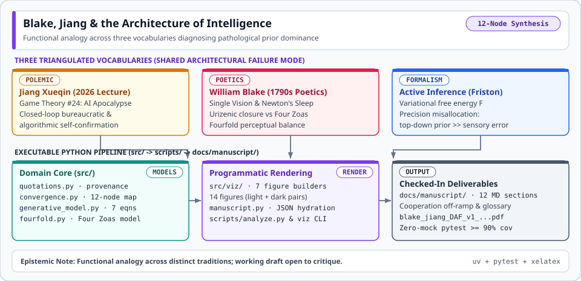

# Blake, Jiang, and the Architecture of Intelligence

**A rapid-publication, AI-augmented scholarly response to Professor Jiang Xueqin's *Game Theory #24: The AI Apocalypse* (12 May 2026), triangulating Jiang's contemporary commentary on artificial intelligence with William Blake's perceptual diagnostics of the 1790s and Karl Friston's Active Inference framework.**

> ⚠️ **A note on form.** This paper is an experiment in rapid AI-augmented scholarly publication with society-in-the-loop. It was drafted on 12 May 2026 in response to a YouTube lecture published the same day. The drafting process used contemporary AI assistance for transcript research, structural mapping, formal derivation, and figure rendering, while editorial judgment, quotation provenance, scholarly framing, and the final synthetic argument remained with the author. The methodology is not standard peer-reviewed scholarship; it is an attempt to see what becomes available when publication latency is collapsed from months to hours. Readers are invited to read in that spirit: a working draft, posted in the open, inviting correction.



## The Paper

Read the [canonical manuscript source](docs/manuscript/README.md) or the
[version 1 PDF from May 12, 2026](blake_jiang_DAF_v1_05-12-2026.pdf). The
historical PDF remains available as originally rendered.

The author's earlier related work (cited throughout):

- *The Doors of Perception are the Threshold of Prediction: Active Inference and William Blake's Theory of Seeing* — Zenodo [10.5281/zenodo.18600041](https://zenodo.org/records/18600041)
- *Before Pragmatism Had a Name: Blake's "America A Prophecy" Anticipates American Anticipatory Epistemology* — Zenodo [10.5281/zenodo.18807971](https://zenodo.org/records/18807971)

## Argument in One Paragraph

Three independent vocabularies — Jiang's polemical lecture form, Blake's mythopoetic visionary apparatus, and the mathematical synthesis developed in the author's earlier Zenodo papers — appear, on the reading offered here, to pick out the same architectural failure mode. That failure mode is what Blake calls *Single Vision* and what cognitive science sometimes describes as *pathological prior dominance*: a perceiving system whose top-down expectations have come to outweigh incoming sensory evidence, so that the model becomes a closed loop confirming itself regardless of what actually happens. Naming this pattern across three vocabularies — Romantic poetics, contemporary public-intellectual polemic, and variational cognitive science — is what the paper attempts, with explicit acknowledgment that the mapping is a *functional analogy across incompatible metaphysics*, not a translation. The Free Energy Principle is itself contested; Jiang's lecture corpus is a speculative source, not a scholarly one. The reading is offered as a working draft, not a finished argument.

## Documentation and local checks

Start at the [documentation index](docs/README.md) for the scholarly method,
quotation provenance, and [development and rendering instructions](docs/development.md).

From the repository root with [uv](https://docs.astral.sh/uv/) installed:

```bash
uv sync --extra dev
uv run python -m scripts.analyze
uv run python -m scripts.generate_figures
uv run pytest tests/ --cov=src --cov-fail-under=90
```

The native commands produce a JSON summary in `output/data/` and 14 PNG files in
`output/figures/`. The manuscript uses the seven light-theme figures. Follow
the pinned render recipe to build the current PDF and HTML.

## Citation

```bibtex
@misc{friedman_blake_jiang_2026,
  author = {Friedman, Daniel Ari},
  title = {Blake, Jiang, and the Architecture of Intelligence:
           A Rapid-Publication Response to {Game Theory \#24: The AI Apocalypse}},
  year = {2026},
  month = may,
  day = {12},
  doi = {10.5281/zenodo.20144984},
  url = {https://github.com/docxology/blake_jiang}
}
```

## License

- **Manuscript and figures** are released under [Creative Commons Attribution 4.0 International](LICENSE-CC-BY-4.0) (CC-BY-4.0).
- **Source code** is released under the [MIT License](LICENSE-MIT).

See [`LICENSE`](LICENSE) for the combined statement.

## Acknowledgments

This rapid response responds, with appreciation and disagreement, to Professor Jiang Xueqin's *Predictive History* lecture corpus and to the Active Inference research community at the Active Inference Institute and adjacent communities. AI drafting assistance was provided by Anthropic Claude. All editorial judgment, quotation provenance, scholarly framing, and the final synthetic argument remain with the author.
